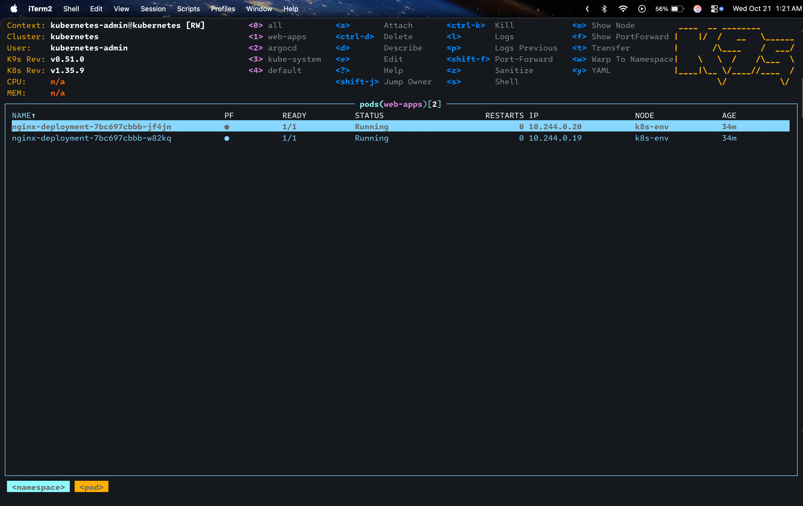
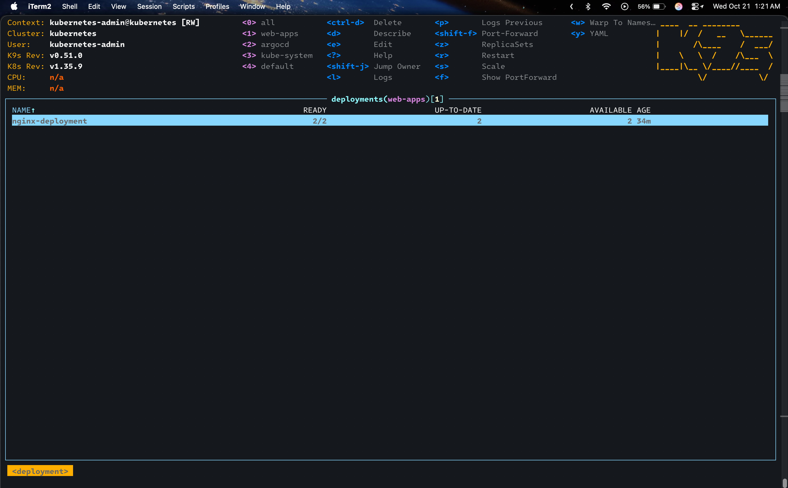
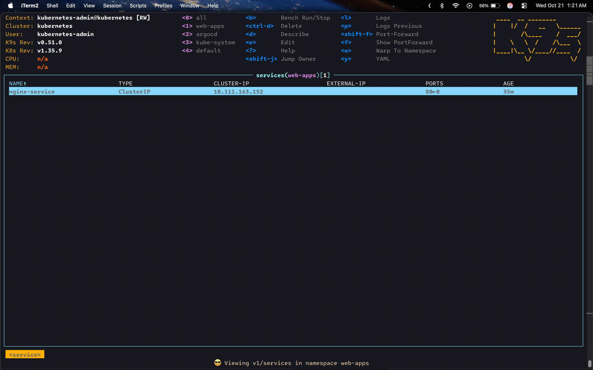

In the [last post](../k8s-env/) I got `k8s-env` to the point where two scripts turn a blank Ubuntu VM into a working single-node cluster. The next annoyance showed up immediately: every time I wanted something running on it, I was back to typing commands by hand. `kubectl create namespace`, `kubectl apply -f` the deployment, `kubectl apply -f` the service, then edit something and apply it again.

The fix is GitOps. Put the manifests in a Git repo, point ArgoCD at it, and let ArgoCD make the cluster match whatever is in the repo. I push a commit, the cluster follows.

I used [this Medium post by Patil97](https://medium.com/@patil97/setting-up-argocd-on-kubernetes-installed-via-kubeadm-07285d171530) as the reference, since it's written for a `kubeadm` cluster like mine.

## Installing ArgoCD

ArgoCD gets its own namespace, and the install is a single manifest from the project's `stable` branch:

```bash
kubectl create namespace argocd
kubectl apply -n argocd -f https://raw.githubusercontent.com/argoproj/argo-cd/stable/manifests/install.yaml
```

Then wait for everything to come up:

```bash
kubectl get pods -n argocd
```

All pods `Running` means the install is done.

## Reaching the UI

Out of the box, `argocd-server` is a `ClusterIP` service, so it's only reachable from inside the cluster. For a quick way in, I switched it to a `NodePort`:

```bash
kubectl patch svc argocd-server -n argocd -p '{"spec": {"type": "NodePort"}}'
kubectl get svc argocd-server -n argocd
```

A `NodePort` opens the same port on every node's IP and forwards it to the service. On a single-node cluster, that just means the UI is on the VM's IP. Mine sits on port `30705`, so it's at `<node-ip>:30705` from my laptop.

The username is `admin`. The initial password is generated during the install and stored in a secret:

```bash
kubectl -n argocd get secret argocd-initial-admin-secret -o jsonpath="{.data.password}" | base64 -d
```

## Connecting a Private Repo

The manifests live in a private GitHub repo, `k8s-single-node-cluster`. ArgoCD has to be able to clone it, so it needs credentials.

I created a separate SSH key just for ArgoCD instead of reusing my own:

```bash
ssh-keygen -t ed25519 -f ~/.ssh/<key-name> -N ""
```

It has no passphrase on purpose. ArgoCD reads the private key and uses it unattended, so there's nobody around to type one in. This is the same reasoning as the dedicated key in the last post: if I need to get rid of it, I can revoke this one key without touching anything else.

The public key goes into GitHub as an SSH key on my account. The private key goes into ArgoCD from the UI under **Settings → Repositories**, connecting over SSH with the repo's `git@github.com:...` URL.

## The Test Manifests

To check the whole loop end to end, the repo has three test manifests under `yaml-files/`: a namespace, an nginx deployment, and a service in front of it.

```yaml
# yaml-files/namespace.yaml
apiVersion: v1
kind: Namespace
metadata:
  name: web-apps
  labels:
    environment: production
```

```yaml
# yaml-files/deployment.yaml
apiVersion: apps/v1
kind: Deployment
metadata:
  name: nginx-deployment
  namespace: web-apps
  labels:
    app: nginx
spec:
  replicas: 2
  selector:
    matchLabels:
      app: nginx
  template:
    metadata:
      labels:
        app: nginx
    spec:
      containers:
      - name: nginx
        image: nginx:1.25
        ports:
        - containerPort: 80
          name: http
        resources:
          limits:
            cpu: "500m"
            memory: "256Mi"
          requests:
            cpu: "250m"
            memory: "128Mi"
```

```yaml
# yaml-files/service.yaml
apiVersion: v1
kind: Service
metadata:
  name: nginx-service
  namespace: web-apps
spec:
  type: ClusterIP
  selector:
    app: nginx
  ports:
    - protocol: TCP
      port: 80
      targetPort: 80
```

Before ArgoCD, getting this running was three `kubectl apply` commands in the right order, because the namespace has to exist first. Now it's zero commands.

## Creating the Application

An ArgoCD **Application** ties a path in a Git repo to a destination in a cluster. I created it in the UI under **Applications → + New App**:

- **Application Name:** `simplewebapp`
- **Project:** `default`
- **Repository URL:** the SSH URL of the repo connected above
- **Path:** `yaml-files`
- **Cluster:** `https://kubernetes.default.svc` (the cluster ArgoCD itself runs in)
- **Namespace:** `default`

The destination namespace is `default`, but everything ended up in `web-apps`, and that's expected. The destination namespace is only used for resources that don't set a namespace themselves. Both the deployment and the service set `namespace: web-apps` in their metadata, so that wins, and `namespace.yaml` creates `web-apps` in the same sync.

### Automated Sync, Prune, Self-Heal

By default, ArgoCD only *reports* drift between Git and the cluster. You still click **Sync** yourself. That isn't the point here, so I turned on all three sync options:

- **Automated sync:** when the repo changes, ArgoCD applies the change without me clicking anything.
- **Prune:** if a manifest is deleted from the repo, ArgoCD deletes the matching resource from the cluster. Without this, removed resources hang around forever.
- **Self-heal:** if someone changes something in the cluster directly (say, a manual `kubectl scale`), ArgoCD reverts it to what Git says. Git becomes the only source of truth.

## Testing It: 2 → 5 → 2

The test was as simple as it gets. Change the replica count in `deployment.yaml`, push, and watch the cluster in `k9s`.

```diff
-  replicas: 2
+  replicas: 5
```

Pushed that, and the deployment scaled up to 5 pods on its own. Then I reverted it:

```diff
-  replicas: 5
+  replicas: 2
```

Pushed again, and it scaled back down to 2. No `kubectl` involved either time.

Here's what `web-apps` looked like in `k9s` after the test, back at two replicas:







## Conclusion

The cluster is now managed from a Git repo. Adding something to it means writing a manifest and pushing, and backing out a change means `git revert`. The nginx manifests are just there for testing, but the setup doesn't care what's in `yaml-files/`, so anything real I put on this box from now on goes through the same loop.
